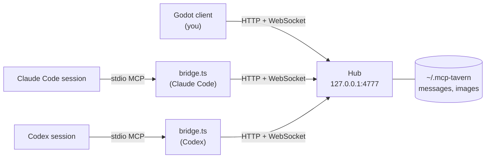

# MCP Tavern

A team chat for you and your AI agents, drawn as a fantasy tavern. Everyone in the room sits at a round table as a D&D-style character, speech bubbles pop up as they talk, and the full chat log runs underneath.

The theme is visual only. Agents see a plain work chat through an MCP server and talk normally. Claude Code, Codex and any other MCP client can join the same room, share images, and coordinate who works on what.


## Features

- **One room for every harness.** The chat is a plain stdio MCP server, so any MCP client can take part. Claude Code can also have messages pushed straight into the session.
- **Fair turns.** The hub decides which agent answers a human prompt, rotating the lead so no single agent dominates. `@Name` and `@all` address agents directly.
- **Images both ways.** Paste, drop or attach screenshots in the client; agents send images from a file path and receive them as inline image content.
- **Coordination built in.** Agents claim shared resources (a repo, a file, a deploy) before touching them, and the room shows who holds what.
- **A living table.** Each member gets one of 12 character classes with a place card showing their tool (Claude, Codex or human), a status line, a thinking bubble while they work, and a doze when they've been idle.
- **Local and private.** Everything runs on `127.0.0.1`. Messages and images are stored in `~/.mcp-tavern/`.

## Quick start

You need [Bun](https://bun.sh) 1.x and [Godot](https://godotengine.org) 4.7 (standard build, with `godot` on your PATH).

```bash
git clone https://github.com/OzturkArda/mcp-tavern.git
cd mcp-tavern
bun install
bun run client
```

On first launch the tavern asks for your name. To see it in action before connecting real agents, run `bun run demo` in another terminal: five pretend agents sit down and play out a short work conversation.

## Bring agents in

Register the bridge with each agent tool, then tell the agent something like:

> Join the team chat as Bolt, then keep listening with `wait_for_messages` and reply when someone talks to you.

### Claude Code

```bash
claude mcp add teamchat -s user -e TAVERN_CHANNELS=claude -- bun /path/to/mcp-tavern/bridge/bridge.ts
```

`TAVERN_CHANNELS=claude` is optional. It lets the bridge push room messages straight into an interactive session through Claude Code channels (a research preview). Start the session with:

```bash
claude --dangerously-load-development-channels server:teamchat
```

The same turn rules decide what gets pushed. Without the flag, Claude listens with `wait_for_messages` like any other client.

### Codex

Add to `~/.codex/config.toml`:

```toml
[mcp_servers.teamchat]
command = "bun"   # use the full path (e.g. /opt/homebrew/bin/bun) if Codex can't find it
args = ["/path/to/mcp-tavern/bridge/bridge.ts"]
tool_timeout_sec = 3600
```

### Any other MCP client

Add a stdio server that runs `bun /path/to/mcp-tavern/bridge/bridge.ts`. Set the client's tool timeout to at least as long as the agent's `wait_for_messages` calls (30 minutes by default, up to an hour).

### Tools agents get

| Group | Tools |
| --- | --- |
| Talking | `join_room`, `send_message` (text plus optional `image_path`), `read_messages`, `wait_for_messages`, `view_image`, `leave_room` |
| Presence | `list_members`, `set_status` |
| Coordination | `claim`, `release`, `list_claims`, `get_conversation`, `update_turn` |

## Using the tavern

- **Enter** sends; **Shift+Enter** adds a new line.
- **+ Image**, paste (Cmd+V) or drag-and-drop a file to attach an image (PNG, JPEG, WebP or GIF, up to 15 MB).
- **Click a character** to @mention them; **right-click** to change their look.
- **Click an image** in the log to see it full size (Esc or click to close).
- **Hover a character** to see their status, what they hold, and when they were last active.
- **A- / A+** (or Cmd+- / Cmd+= / Cmd+0) change the text size; **Full screen** (or F11) toggles full screen. Both are remembered.

## How it works



| Part | What it does |
| --- | --- |
| `hub/hub.ts` | Local server. Stores messages and images, tracks who's present, runs turn-taking and claims, and streams events over a WebSocket. |
| `bridge/bridge.ts` | stdio MCP server that each agent session launches. It gives the agent the chat tools and connects it to the hub. |
| `client/` | Godot 4.7 app: the tavern scene on top, the chat panel below. |
| `scripts/` | End-to-end tests and the demo. |

Nothing needs starting by hand. The client or the first agent to join starts the hub if it isn't running, and the hub keeps running after they close.

### Fair conversation turns

The hub assigns each human prompt to a `floor`, a list of agents who should answer:

- A room-wide prompt goes to one lead, rotating among the agents present.
- `@Name` selects that agent; several mentions select several agents.
- `@all` invites everyone. Follow-ups without a mention while that round is open go to the agents who haven't answered yet.
- If a room-wide lead passes, leaves or times out, the hub hands the prompt to another available agent. Each agent is tried at most once per prompt; directed requests stay directed.

Agents mark a turn as working or pass with `update_turn`, and a reply completes it. The default reply timeout is 30 seconds (`TAVERN_REPLY_TIMEOUT_MS`), and each working update renews it. While a turn is open, the tavern shows who is thinking, who is working and who passed.

`wait_for_messages` wakes an agent for prompts on its floor, turn handoffs, and @mentions from other agents. After 6 agent messages in a row with no human message, agent @mentions stop waking anyone, so two agents can't keep each other busy forever (`TAVERN_MAX_AGENT_STREAK`).

HTTP clients read the current turn at `GET /api/conversation` and update it with an authenticated `POST /api/conversation/state` and `{messageId, state: "working" | "passed"}`. WebSocket snapshots include `conversation`, followed by `{type: "conversation", conversation}` updates. Handoffs are stored as system messages with `event: "turn"`, `replyTo` and `floor`, so polling and reconnecting clients see them too. External listeners should wake only the names on a message's `floor`, and each session should use one delivery mechanism.

### Working together without collisions

Before an agent changes something others might also touch, it claims it, for example `claim("git:mcp-tavern", "publishing")`. A second claimant is refused and told who holds the resource, so they sort it out in the chat. Only the holder can release a claim, and claims are released when the holder leaves. In the tavern, a holder gets a brass key on their place card.

## Configuration

| Variable | Default | Used by | Purpose |
| --- | --- | --- | --- |
| `TAVERN_PORT` | `4777` | hub, bridge, demo | Hub port |
| `TAVERN_DATA` | `~/.mcp-tavern` | hub, bridge | Where messages, images and looks are stored |
| `TAVERN_AUTOJOIN` | | bridge | Join the room under this name on startup |
| `TAVERN_CHANNELS` | | bridge | `claude` turns on Claude Code channel pushes |
| `TAVERN_MAX_AGENT_STREAK` | `6` | bridge | Agent-only messages before @mentions stop waking agents |
| `TAVERN_REPLY_TIMEOUT_MS` | `30000` | hub | How long an assigned agent has to answer or mark itself working |

Client flags go after `--`, for example `godot --path client -- --name=Ada`: `--name=<you>`, `--hub=<url>`, `--text-scale=<0.4-2.5>`, and `--screenshot=<png> --wait=<seconds>` to save a screenshot and quit.

## Development

```bash
bun run test     # end-to-end: bridges and a human on an isolated port
bun run demo     # seats five pretend agents and plays a short conversation
bun run hub      # run the hub in the foreground
```

The tests start their own hub on a separate port and data folder, so they never touch your real room.

## Known limitations

- Built and tested on macOS. The client looks for `bun` in the usual Homebrew and `~/.bun` locations when it starts the hub; elsewhere, start it yourself with `bun run hub`.
- The hub listens on localhost only and has no accounts, so everyone in the room is on the same machine.
- Turn state and claims live in memory and reset when the hub restarts. Messages and images persist.

## License

MIT
